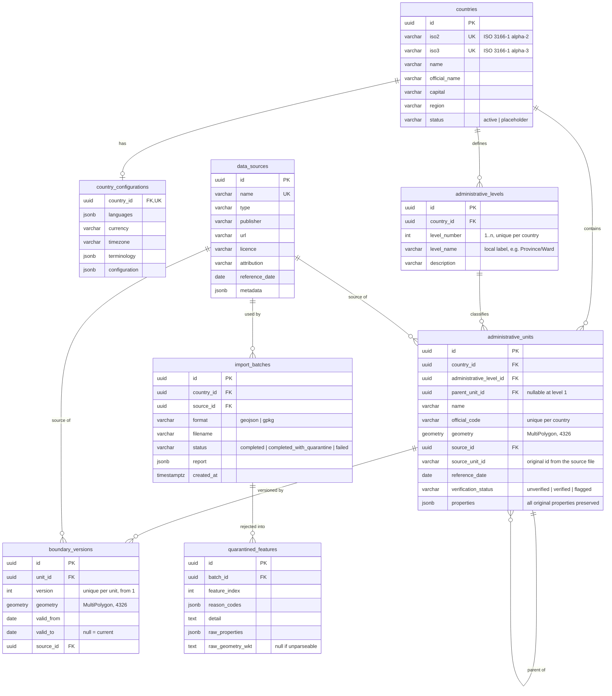

# OpenAid — Database Schema

> Status legend: ✅ implemented in the PoC (`poc/geography-spatial/`) ·
> 🔜 planned (documented for the full application, not yet created).

## 1. Conventions

- Primary keys are UUIDs (`gen_random_uuid()`), generated by the database.
- Country identity: ISO 3166-1 alpha-2 (`iso2`) and alpha-3 (`iso3`);
  alpha-3 is the external identifier used in URLs and fixtures.
- Geometries: `geometry(MultiPolygon, 4326)` for areas; points will be
  `geometry(Point, 4326)` in later phases. EPSG:4326 is the storage and
  exchange CRS; projected CRS choices happen at query time.
- All timestamps are `timestamptz`.
- Enumerations are PostgreSQL enums or CHECK constraints — no free-text
  status fields where state matters.
- History is append-only: `boundary_versions` rows are never updated or
  deleted once written.

## 2. PoC schema (geography & spatial) ✅

### 2.1 Integrity rules ✅

| Rule | Enforcement |
| --- | --- |
| Unique ISO codes | UNIQUE on `countries.iso2`, `countries.iso3` |
| Level numbering | UNIQUE (`country_id`, `level_number`); `level_number >= 1`; level names required |
| Parent-child consistency | FK on `parent_unit_id`; **database trigger** `trg_unit_parent_consistency`: parent must exist, belong to the same country, and be exactly `level_number - 1`; root units must be level 1 |
| Duplicate source identifiers | UNIQUE (`country_id`, `source_id`, `source_unit_id`) on `administrative_units` |
| Duplicate official codes | UNIQUE (`country_id`, `official_code`) |
| Geometry type & SRID | typmod `geometry(MultiPolygon,4326)` rejects wrong type/CRS at the database |
| Boundary version monotonicity | UNIQUE (`unit_id`, `version`); current mirror kept in `administrative_units.geometry` |
| No silent history loss | unit geometry updates write a new `boundary_versions` row (next version) |

### 2.2 Indexes ✅

- `administrative_units`: GiST on `geometry` (spatial queries), btree on
  (`country_id`, `administrative_level_id`), btree on `parent_unit_id`,
  btree on `official_code`.
- `boundary_versions`: btree (`unit_id`, `version`).

### 2.3 Migrations ✅

Alembic (`poc/geography-spatial/migrations/`):

| Revision | Content |
| --- | --- |
| `0001_initial_geography` | All PoC tables, enums, indexes, unique constraints |
| `0002_parent_consistency_trigger` | Trigger enforcing parent level/country rules |

## 3. Planned domains 🔜 (full application — blueprint §12)

These are documented now so the PoC schema evolves without dead ends; they
are **not** created until their phase.

| Domain | Tables | Phase |
| --- | --- | --- |
| Organisations | `organisations`, `organisation_offices`, `organisation_sectors`, `organisation_locations` | 1 |
| Projects | `projects`, `project_organisations`, `project_sectors`, `project_locations` | 1 |
| Services | `facilities`, `facility_types`, `facility_services`, `facility_locations` | 1 |
| Indicators | `indicator_definitions`, `indicator_observations`, `indicator_methodologies`, `comparability_assessments` | 1–3 |
| Datasets | `datasets`, `dataset_files`, `dataset_versions`, `dataset_licences` | 1–2 |
| Provenance (extends PoC) | `source_records`, `data_lineage`, `transformation_logs` | 2 |
| Governance | `users`, `roles`, `permissions`, `submissions`, `reviews`, `audit_logs` | 2 |
| Platform | `translations`, `classification_mappings`, `api_clients`, `api_usage_logs` | 2+ |

### 3.1 Indicator design notes 🔜

- Observations link (unit, indicator, period, source, dataset version,
  methodology, sample size, quality status).
- Missing values are **never zero**: explicit `NULL` plus a distinction
  code (unknown / not-collected / not-applicable / suppressed / unavailable).
- Comparability: explicit assessment values — `directly_comparable`,
  `comparable_with_adjustments`, `contextually_comparable`,
  `not_comparable`, `not_assessed`.

### 3.2 Organisation presence notes 🔜

Headquarters, registration, country office, operational location and project
implementation site are **separate facts**, each with source evidence, dates
and verification status. Presence is never inferred from registration alone.
